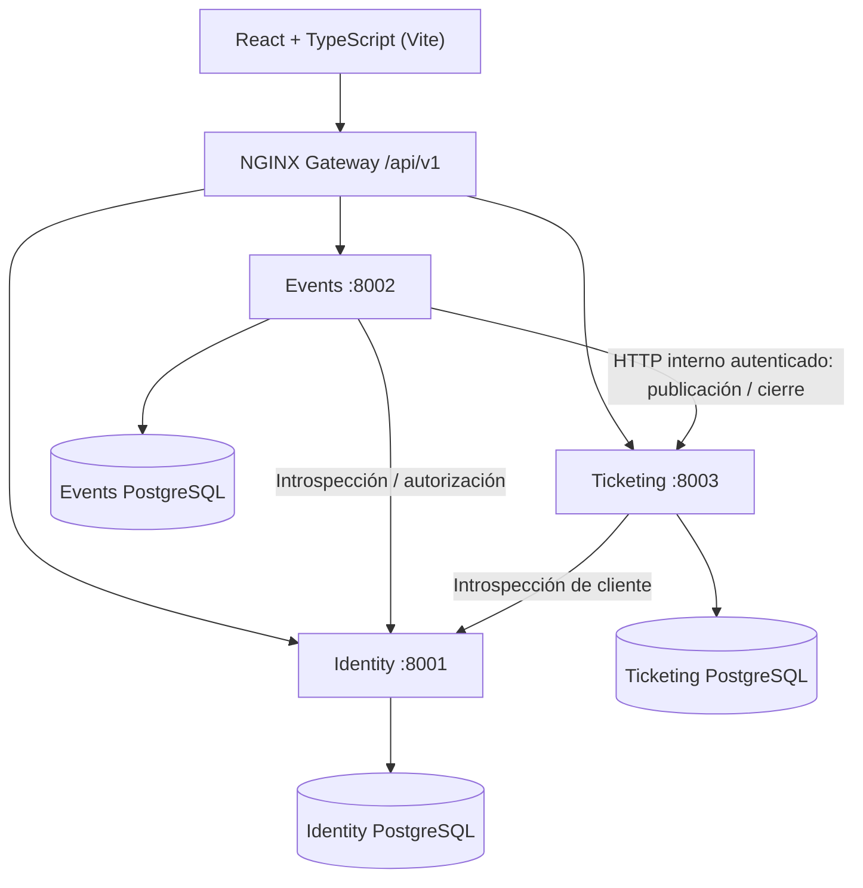

# Ticketing TP — Tópicos II 2026

Trabajo práctico grupal de tres integrantes, basado metodológicamente en [ticketin](https://github.com/jwackito/ticketin), con implementación propia en Python/FastAPI, React, PostgreSQL y Docker.

## Estado del proyecto (25/11/2026)

**Etapa I funcional y arquitectura H1–H5 implementadas y validadas en entornos aislados de integración.** El responsable del proyecto aceptó el alcance **académico acotado** de H5. Quedan pendientes la revisión independiente de equipo/QA y el archivo formal del change OpenSpec.

El repositorio conserva **dos modalidades diferentes**:

- **Legacy / demo inicial:** `docker-compose.yml` levanta el backend monolítico FastAPI, React y su PostgreSQL. Las instrucciones de inicio rápido de abajo corresponden a esta modalidad.
- **H5 / arquitectura independiente:** composición optativa de **Identity, Events, Ticketing y NGINX Gateway**, con tres bases PostgreSQL independientes. Se verifica sin fallback hacia Legacy, con pruebas HTTP, tres roles y React en Chromium. **Es un entorno descartable de UAT, no un cutover ni una instalación productiva.**

No hay pagos reales ni migración productiva de usuarios, órdenes o tickets. Etapas II (recomendación/caché) y III (colas, devoluciones, búsqueda avanzada y pruebas de carga) no forman parte del alcance H5 aceptado.

## Arquitectura H5



| Componente | Responsabilidades |
| --- | --- |
| **Identity** | Usuarios, roles, login/logout, sesiones e introspección interna |
| **Events** | Metadatos, borradores, propietario, publicación y despublicación |
| **Ticketing** | Zonas, asientos, inventario, órdenes, tickets, claves idempotentes y puerta de ventas |
| **Gateway** | Enrutamiento por ruta pública, rechazo de rutas internas, propagación de headers y bitácora HTTP |

**Patrones utilizados:** separación por capacidades de negocio y *database per service*; Gateway; puertos y adaptadores/hexagonal en componentes clave (no uniformemente en todos los módulos); *Unit of Work* transaccional en compras; bloqueos PostgreSQL y control de versiones; idempotencia de órdenes y comandos; coordinación recuperable de publicación/despublicación sin transacciones SQL distribuidas; RBAC, *fail-closed* y correlación mediante `X-Request-ID`.

Ticketing mantiene el descuento de stock, la orden y la emisión de tickets en **una única transacción local**. Events coordina apertura/cierre con comandos versionados y persistentes en Ticketing. Un reintento con la misma clave recupera el resultado original sin duplicar la compra.

Más detalles: [decisiones arquitectónicas](docs/ADR-0005-microservices-hexagonal.md), [compras y Unit of Work](docs/ADR-0006-ticketing-hexagonal-purchase.md), [protocolo de puerta de ventas](docs/ADR-0013-events-ticketing-sale-gate.md), [matriz React–OpenAPI](docs/H5-FRONTEND-OPENAPI-CONTRACTS.md).

## Ejecutar Legacy en local (Docker Desktop)

Estas instrucciones **no** arrancan los tres microservicios H5:

```bash
cp .env.example .env
docker compose up --build -d
docker compose exec backend alembic upgrade head
```

En PowerShell, usar `Copy-Item .env.example .env` en lugar de `cp` si se prefiere el comando nativo.

| Recurso Legacy | Dirección local |
| --- | --- |
| Frontend | http://localhost:5173 |
| API | http://localhost:8000/api/v1 |
| Swagger | http://localhost:8000/docs |
| Salud | http://localhost:8000/health |
| PostgreSQL | 127.0.0.1:5433 |

### Verificaciones Legacy

```bash
docker compose exec backend ruff check .
docker compose exec backend mypy app
docker compose exec -e TEST_POSTGRES_URL=postgresql+psycopg://ticketing:local-dev-only@db:5432/ticketing backend pytest -q
docker compose exec frontend npm run lint
docker compose exec frontend npx tsc --noEmit
docker compose exec frontend npm test
```

La URL del test usa las credenciales **exclusivas del entorno local** definidas en Compose. Ajustar si fueron modificadas. No usar credenciales productivas.

## Ejecutar H5 como UAT descartable

**No combinar estos overlays con `docker-compose.yml`, bases o volúmenes Legacy.** Las bases H5 usan `tmpfs` y se pierden al destruir sus contenedores. En Windows, abrir PowerShell en la raíz del repositorio y configurar tres secretos **aleatorios de prueba**, no credenciales reales:

```powershell
$env:H3_INTERNAL_TOKEN = "<valor aleatorio de 32+ caracteres>"
$env:H4_SALES_TOKEN = "<otro valor aleatorio de 32+ caracteres>"
$env:H3_TEST_PASSWORD = "<contrasena aleatoria solo para UAT>"
$files = @(
  "-f", "docker-compose.h3-contract.yml",
  "-f", "docker-compose.h4-live.yml",
  "-f", "docker-compose.h5-gateway-preview.yml"
)
docker compose -p h5-gateway-uat @files config
docker compose -p h5-gateway-uat @files build h3-identity h3-events h4-ticketing h5-gateway-smoke
docker compose -p h5-gateway-uat @files up -d --wait h3-identity-db h3-events-db h4-ticketing-db
foreach ($service in @("h3-identity", "h3-events", "h4-ticketing")) {
  docker compose -p h5-gateway-uat @files run --rm --no-deps $service alembic upgrade head
}
docker compose -p h5-gateway-uat @files run --rm --no-deps h3-identity python -m identity.h3_contract_seed
docker compose -p h5-gateway-uat @files run --rm --no-deps h3-identity python -m identity.h5_admin_seed
docker compose -p h5-gateway-uat @files up -d --wait h3-identity h3-events h4-ticketing h5-gateway
curl.exe -i http://127.0.0.1:8091/health
docker compose -p h5-gateway-uat @files run --rm --no-deps h5-gateway-smoke
```

La puerta HTTP H5 se publica **solo en loopback**, `http://127.0.0.1:8091`. El Frontend de la UAT completa utiliza un proxy Vite hacia ese Gateway; véase el job `h5-gateway-stage-i` de [GitHub Actions](.github/workflows/ci.yml), que también ejecuta Chromium, recuperación tras reinicio, restauración aislada y pruebas de aborto seguro.

Al finalizar, bajar **únicamente** este proyecto descartable:

```powershell
docker compose -p h5-gateway-uat @files down
```

No ejecutar `down -v` ni comandos de restauración destructiva sobre otros proyectos.

## Calidad, pruebas y evidencias

CI en GitHub Actions comprueba backend y frontend Legacy, servicios Identity/Events/Ticketing, contratos H3, HTTP H4 (incluida concurrencia y pérdida de ACK simulada), Gateway H5, React real en Chromium, restauración aislada y validaciones OpenSpec.

- [Evidencias de H5 y runs CI comprobados](docs/H5-FINAL-ACCEPTANCE-EVIDENCE.md)
- [Acta de aceptación del prototipo académico](docs/H5-TECHNICAL-ACCEPTANCE-DECISION.md)
- [Guía de demo original de Etapa I](docs/ETAPA-I-DEMO-GUIA.md)
- [Plan del equipo](docs/PLAN-EQUIPO.md)
- [Bitácora del proyecto](docs/BITACORA.md)
- [Contribución](CONTRIBUTE.md)

**Limitaciones verificadas:** las pruebas de `pg_restore` no demuestran paridad fila por fila de un clúster recuperado; la pérdida de ACK se simula con HTTP 503 después del commit, no con una caída real del proceso; el rollback contra Legacy solo tiene runbook y guardia simulada. No se implementó un broker, *transactional outbox* ni un cutover productivo.

## Etapas de trabajo y OpenSpec

- **Etapa I:** funciones de ticketera, UI React, autenticación, eventos, inventario y compra simulada.
- **H1–H5:** migración incremental a componentes hexagonales y tres microservicios independientes, con Gateway y aceptación de alcance académico.
- **Etapa II (pendiente):** recomendación y caché.
- **Etapa III (pendiente):** colas, devoluciones, búsqueda avanzada y *stress tests*.

El change [`h5-gateway-stage-i-cutover`](openspec/changes/h5-gateway-stage-i-cutover/tasks.md) **no está archivado**: falta la revisión técnica/QA independiente y la decisión formal de archivo. La aceptación del responsable no autoriza producción.

## Advertencia operativa

**PRODUCTION CUTOVER = NO-GO.** Los flags comerciales de UAT son exclusivos de overlays descartables. No hay garantía de despliegue productivo, pagos reales, backfill de Legacy, un único escritor en la transición, recuperación integral ni rollback postventa probado.
