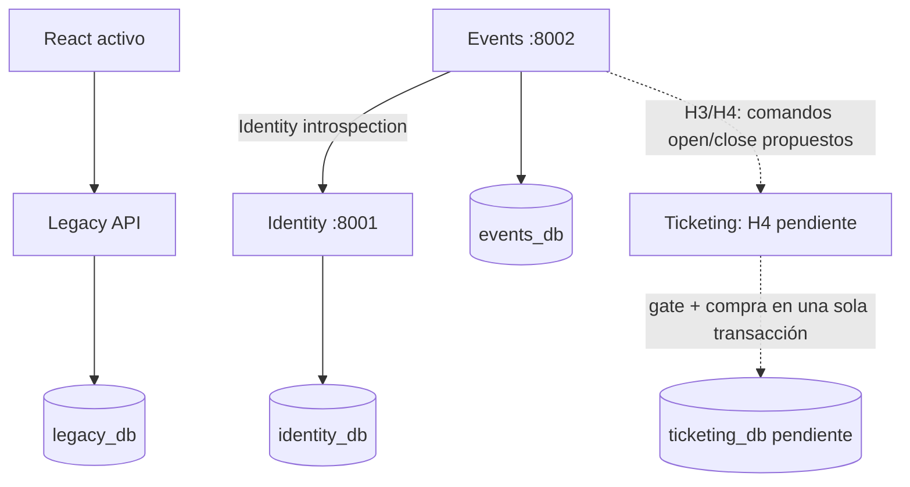

# ADR-0013 — Gate transaccional de ventas entre Events y Ticketing

**Estado: propuesto, no implementado.** Fecha: 24/11/2026. Complementa ADR-0005 y define el contrato de coordinación requerido por H3/H4.

## Problema real

Actualmente Legacy conserva `Event`, `Zone`, `Order` y `Ticket` en una sola base. En la separación, Events ya opera sobre `events_db` e Identity sobre `identity_db`, mientras compras e inventario continúan en Legacy. No podemos reemplazar el control de venta por dos consultas HTTP separadas: una compra puede confirmarse entre el chequeo de ventas y la despublicación.

## Decisión propuesta

**Ticketing es la única autoridad sobre la apertura/cierre de ventas.** Su futura base `ticketing_db` guardará una puerta por evento (`closed/open`, versión monotónica y registro de comandos). La compra y el cierre toman el **mismo bloqueo de fila en una única transacción PostgreSQL de Ticketing**. No existe transacción distribuida.

Events es propietario del nombre, fechas, propietario, descripción y estado `draft/published`. Solicita `open/close` a Ticketing por HTTP interno autenticado. La actualización de metadatos nunca supone que un timeout significa éxito. La puerta permanece cerrada por defecto; una respuesta incierta exige consulta de estado/reconciliación.

El orden conservador es:
1. Publicar metadatos en Events; luego solicitar apertura con revisión y versión. Si falla apertura, el evento puede verse publicado pero **no** se pueden vender entradas.
2. Solicitar cierre en Ticketing, esperar confirmación duradera y **después** despublicar en Events. Si cae Events tras el cierre, las ventas quedan detenidas; el operador reconcilia. No reabrir automáticamente.
3. Un replay de una compra ya confirmada retorna su resultado original aunque las nuevas compras se encuentren cerradas. La idempotencia y el inventario permanecen bajo la misma autoridad transaccional.

Se rechazan versiones obsoletas, comandos duplicados divergentes, cambios de rol no autorizados y fallos de red que puedan llevar a ventas inseguras. La política exacta de revisión de metadatos e identificación de servicio debe probarse antes de activar rutas.

## Diagrama sencillo

**Línea punteada = contrato propuesto, no servicio implementado.** React aún no usa microservicios a través de Gateway.

## Pruebas de aceptación obligatorias

- Carrera compra vs. cierre con ambas órdenes de bloqueo y consistencia de inventario.
- Replay de compra confirmada después del cierre.
- Repetición de comando con mismo `command_id`, colisión con payload distinto, versión anterior.
- Timeout HTTP, fallo tras commit y antes de responder, reinicio y reconciliación.
- Caída de Identity y Ticketing, acceso no autorizado a endpoints internos.
- Migración de datos/UUIDs con backup-restore y regresión Legacy.

## Limitaciones conscientes

El diseño exige un protocolo concreto de revisión/versionado y recuperación; esta ADR **no crea** el gateway ni el servicio Ticketing, ni certifica que H3 esté completo. Ninguna ruta de despublicación remota debe activarse antes de cumplir estas pruebas.
