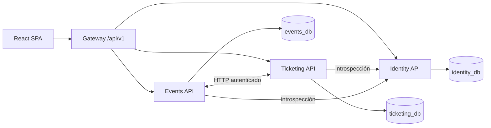

# Plan de ejecución — microservicios + hexagonal (primera entrega)

**Estado:** plan de corrección de conformidad arquitectónica. La Etapa I previa pasó pruebas funcionales, pero **no cumple aún la arquitectura obligatoria**.

## Diagrama de referencia (objetivo, no implementado)

### Pasos que NO debemos omitir

| Incremento | Resultado verificable | Riesgo principal |
| --- | --- | --- |
| H1. Núcleo hexagonal | Dominios/casos de uso puros, puertos y adaptadores inyectados, tests de arquitectura | Cambiar accidentalmente hash o transacciones |
| H2. Identity aislado | Servicio con DB, CLI admin, login/introspect internos y tests de revocación | Permisos inconsistentes |
| H3. Events aislado | DB/event metadata propia, contrato de estado de venta; sin FK a User | Carreras entre publicación y compra |
| H4. Ticketing aislado | DB exclusiva para inventario+órdenes+tickets, PostgreSQL locks y tests portados | Sobreventa e idempotencia |
| H5. Gateway y UAT | Mismo `/api/v1` para React, Compose y CI multi-servicio, pruebas extremo a extremo | Integración y fallos parciales |

Se parte del código existente de `backend/app`; **no** crear controladores duplicados sin pruebas ni arrancar servicios vacíos solo para contar contenedores.

## Inventario reutilizable

- `frontend/`: React, Vite, catálogo y CoreWorkspace; mantener API pública.
- `backend/tests/`: suites funcionales y PostgreSQL (baseline anterior: 146 pass; verificar de nuevo tras cada etapa).
- `backend/app/purchasing.py`: locks, constraints, idempotencia y emisión a extraer con cautela.
- `backend/alembic/`: historia a dividir mediante migraciones separadas; crear una rutina de migración de datos **solo** si existe necesidad de conservar la BD de demo, con backup/restore.
- `docs/ADR-0005-microservices-hexagonal.md`: fuente de decisiones y condiciones de aceptación.

## Política de PRs

- Cada hito en rama propia, OpenSpec proposal/specs/design/tasks, pruebas independientes y CI verde.
- No alterar `main` sin tests/regresión y revisión.
- Evidencias nuevas de fallos parciales, integridad y funcionamiento local; no presentar la arquitectura objetivo como realidad.
- Ninguna tarea de Etapa II (recomendaciones/caché) hasta cerrar los hitos de conformidad.
