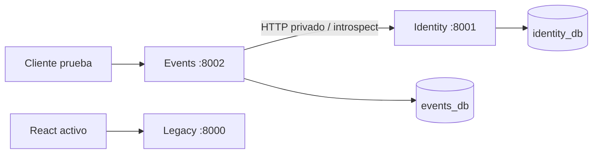

# H3 — Authenticated event drafts preview

This increment adds an **opt-in**, write-capable draft endpoint to the independent Events Service. The published catalog stays read-only; no publish/unpublish operation is exposed. No Legacy data is migrated, and the React /api/v1 API still points to the Legacy backend.

## Path

1. A client sends POST /api/v1/events to Events preview with its Identity bearer token.
2. Events calls Identity's **private** /internal/auth/introspect endpoint, authenticated with X-Internal-Service-Token. The client cannot choose owner_id.
3. Only an Identity principal with event_owner or administrator may create a draft. A revoked token returns 401; wrong role returns 403; Identity outage, unexpected response or invalid configuration returns 503.
4. Events writes the draft to its own events_db and commits. No external foreign key exists.

## Deploy guardrails

Disabled by default (PROTECTED_DRAFTS_ENABLED=false). To enable in local demo, the operator must opt into the separate docker-compose.events-identity.yml overlay, provide a 32+ character IDENTITY_INTERNAL_TOKEN, and start the Identity and Events profiles together. Never set these values in tracked files. Backend Legacy and React remain unchanged.

This proof does not claim atomic role-revocation ordering across Identity and Events databases. A role can change between introspection and Events commit. Draft creation is noncommercial and has no impact on stock or orders; publication and editing commercial state are **not enabled**. The strict coordination gate from ADR-0011 remains required before any cross-service operation affecting sales.

## Diagrama simple

## Acceptance

- Unit and HTTP tests: authenticated draft 201, client-provided owner_id 422, anonymous/revoked 401, wrong role 403, upstream unavailable 503, disabled 404, no rows created on rejection.
- GitHub Actions Events job: Ruff, mypy, all tests including isolated PostgreSQL, Alembic, Docker.
- Live opt-in integration test with Identity accounts and separate databases, plus partial-failure checks, before enabling outside a local preview.
