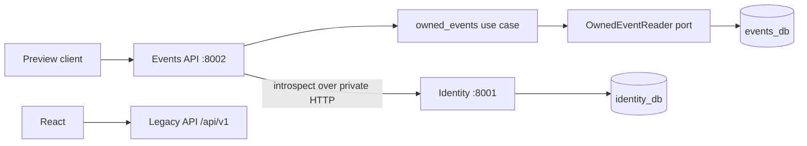

# H3 — Protected organizer listing (incremental vertical slice)

Under OpenSpec change `events-independent-foundation`, this increment adds `GET /api/v1/owner/events` to the independent Events preview service (port 8002).

- Uses existing private Identity introspection, no Legacy user lookup.
- `event_owner` receives only their own drafts/published events, including nonpublic drafts.
- `administrator` receives all events.
- Customer, missing/revoked token, Identity outage fail closed (403/401/503).
- Disabled by default along with the protected Events preview flag; no owner UUID request parameter.
- Domain/application `OwnedEventReader` port and use case, with Events-only SQLAlchemy adapter and filtering.
- No publication/unpublication, stock, checkout or gateway changes. React still points to Legacy.
- No new database migration or change to either existing data store.

## Architecture

Validate Ruff, mypy and full Events pytest in CI (including independent PostgreSQL), then explicit opt-in UAT with the two test owner accounts. Keep the PR draft until both CI and review are complete.

Next H3 milestone: decide publication/sale-state protocol jointly with H4 Ticketing. Do not introduce remote unpublish based only on checking current sales over HTTP.
