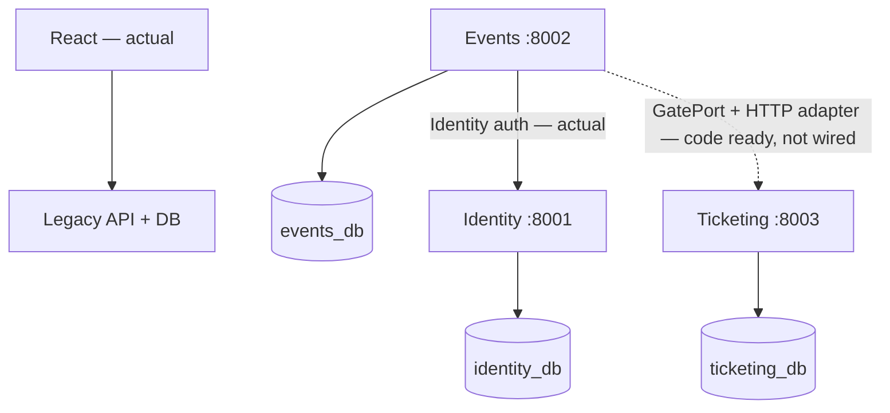

# H3/H4 — Events outbound Ticketing gate client (offline integration)

This PR adds the **outbound seam** from Events to Ticketing under OpenSpec `events-ticketing-sales-state` and ADR-0013. The implementation does not change Events public API or event publication logic.

- `SaleGatePort` is a pure application port; `HttpTicketingGateAdapter` performs private GET and POST with a dedicated Events-to-Ticketing credential, bounded timeout, no redirects, no ambient proxy credentials and optional X-Request-ID propagation.
- Gate state validates the event UUID, allowed state, nonnegative version and event revision.
- A 409 is a rejected command; 401/403/404/5xx, timeout, connection failure, redirect and malformed reply are **unconfirmed/unavailable**, never treated as successful closure or opening.
- Command ID is supplied by the coordinating use case and passed through unchanged for durable idempotency. An uncertain command MUST later reconcile the same command ID before any metadata transition; this PR deliberately does **not** implement that recovery yet.
- No new HTTP route or feature toggle in Events; the adapter is not instantiated by production code or called from an event publication use case.
- Ticketing gates remain unknown/closed without trusted provisioning, so open is not enabled. No changes to Legacy or React.

## Diagram

## Acceptance

- CI: Events ruff, mypy, unit tests, PostgreSQL/Alembic and existing real Identity contract remain green.
- Unit tests: correct service credential/command UUID, 409 conflict, network errors, timeout after possible commit, redirected/invalid response, event UUID mismatch and unexpected command acknowledgement.
- Next increments: trusted gate provisioning and metadata revision; Events orchestration with Identity revalidation and durable pending-command recovery; only then end-to-end commercial coordination and cutover review.
