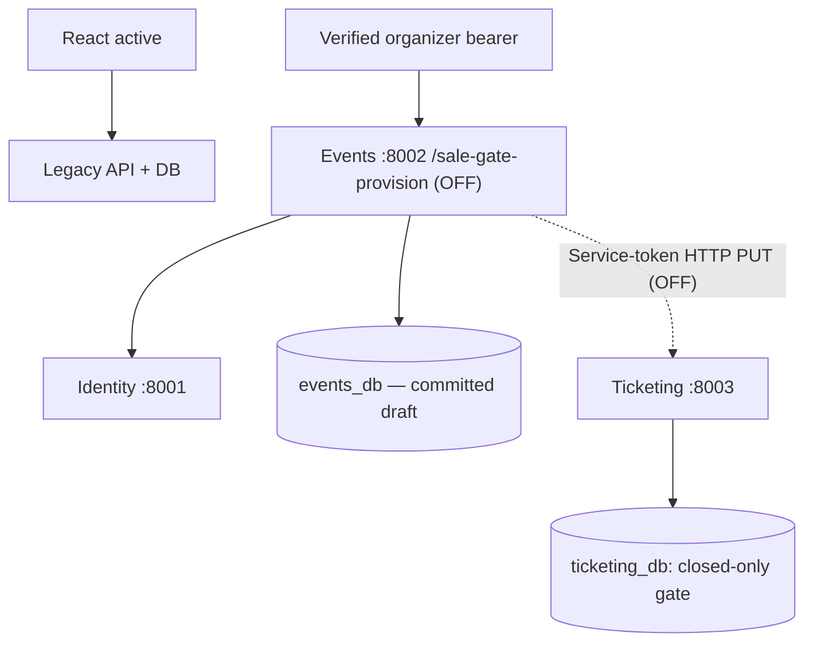

# H3/H4 — Verified Events-to-Ticketing closed-gate provisioning (opt-in)

This increment connects the **Events-owned** verified read model and a fresh Identity introspection to a private, idempotent Ticketing `PUT`:

`PUT /api/v1/owner/events/{event_id}/sale-gate-provision`

The route requires a bearer validated **on every call**, checks the actor is organizer/administrator, loads an existing committed Events future draft, then uses the separate Events→Ticketing service token to request a closed gate. No arbitrary customer-supplied owner is accepted.

The endpoint requires BOTH existing `PROTECTED_DRAFTS_ENABLED` and new `GATE_PROVISIONING_ENABLED`, default false. It also requires `TICKETING_SERVICE_URL` and `TICKETING_INTERNAL_TOKEN` (32+ characters). Ticketing's own `GATE_PROVISIONING_ENABLED` remains false by default. Do not enable flags except in a disposable, isolated multi-service UAT.

The Ticketing PUT is idempotent by event UUID: a repeat after uncertain network delivery cannot reset state or increment version. Timeout, 5xx, redirect, auth failure or malformed receipt returns 503 from Events; the caller must retry the same event UUID and revalidate Identity/ownership. The process does not store an outbound command journal in Events yet: **this is not sufficient for publish/unpublish**, which require durable coordinated sale-state commands and recovery.

The response preserves an existing open gate; **does not claim provisioning implies closed**. No public purchase API, Events publish/unpublish route, Legacy data migration, React routing or cross-database SQL is added.

## UAT and remaining gates

- Verify isolated Events Ruff, mypy and pytest + CI PostgreSQL.
- Verify default-off routes 404, Identity failure/revocation, wrong owner, unknown and published event never calls Ticketing.
- Verify authenticated private PUT, response validation, repeated delivery and timeout.
- Full multi-process HTTP/DB UAT against disposable environments **still required** before enabling the flags.
- Next: command journal + event revision, then safe sale open/close orchestration; only then Gateway and commercial cutover.
