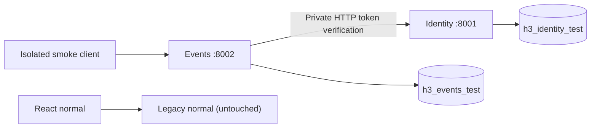

# H3 — Real Identity → Events contract UAT (isolated)

This verifies the H3 opt-in protected draft endpoint end-to-end across two actual FastAPI services and two PostgreSQL instances. No database or ORM is shared across services. Legacy / React / normal Identity / normal Events are not started or modified.

## Architecture under test



## Isolation

- `docker-compose.h3-contract.yml` is **standalone**, not an overlay on `docker-compose.yml`.
- No host ports; use a separate Compose project `-p h3-contract-uat`. The two PostgreSQL data directories use tmpfs rather than shared/persistent Docker volumes.
- All test accounts are created only in `h3_identity_test` via an explicitly gated Identity-owned seed command; Events does not query Identity's database.
- `H3_INTERNAL_TOKEN` and `H3_TEST_PASSWORD` must be newly generated and are never written to a tracked file.
- The smoke never prints token values.

## Local PowerShell (optional)

```powershell
$env:H3_INTERNAL_TOKEN = -join (1..4 | ForEach-Object { [guid]::NewGuid().ToString("N") })
$env:H3_TEST_PASSWORD = -join (1..2 | ForEach-Object { [guid]::NewGuid().ToString("N") })
$project = "h3-contract-uat"
$compose = @("-p", $project, "-f", "docker-compose.h3-contract.yml")
try {
    docker compose @compose build h3-identity h3-events h3-smoke
    if ($LASTEXITCODE -ne 0) { throw "Build failed" }
    docker compose @compose up -d --wait h3-identity-db h3-events-db
    if ($LASTEXITCODE -ne 0) { throw "Isolated databases failed" }
    docker compose @compose run --rm --no-deps h3-identity alembic upgrade head
    if ($LASTEXITCODE -ne 0) { throw "Identity migration failed" }
    docker compose @compose run --rm --no-deps h3-events alembic upgrade head
    if ($LASTEXITCODE -ne 0) { throw "Events migration failed" }
    docker compose @compose run --rm --no-deps h3-identity python -m identity.h3_contract_seed
    if ($LASTEXITCODE -ne 0) { throw "Disposable Identity seed failed" }
    docker compose @compose up -d --wait h3-identity h3-events
    if ($LASTEXITCODE -ne 0) { throw "HTTP services failed" }
    docker compose @compose run --rm h3-smoke --phase online
    if ($LASTEXITCODE -ne 0) { throw "Online contract failed" }
    docker compose @compose stop h3-identity
    docker compose @compose run --rm --no-deps h3-smoke --phase outage
    if ($LASTEXITCODE -ne 0) { throw "Outage contract failed" }
}
finally {
    docker compose @compose down
    Remove-Item Env:\H3_INTERNAL_TOKEN -ErrorAction SilentlyContinue
    Remove-Item Env:\H3_TEST_PASSWORD -ErrorAction SilentlyContinue
}
```

The teardown uses **no** `--remove-orphans` and **no** `down -v`. It cannot target the normal project because the Compose project name is different. Do not reuse this project name if you already have an unrelated project with that name.

## Expected UAT evidence

- Owner login succeeds and `POST Events /api/v1/events` creates exactly one draft with the Identity-derived owner UUID.
- Customer = 403; anonymous = 401; spoofed owner UUID = 422; each rejection leaves Events DB unchanged.
- Owner logout revokes the remote session; retry = 401 and no new draft.
- Identity shutdown while Events continues running = 503 and no new draft.
- CI job `h3-identity-events-contract` runs these checks without relying on user data.

This is **draft creation only**, not safe commercial publication, an Identity/Legacy auth cutover, or H3 completion.
