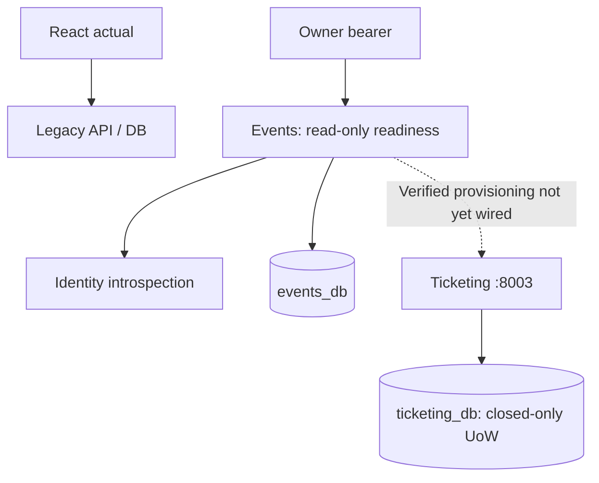

# H3/H4 — Verified event readiness before sale-gate provisioning

This small increment adds an **authenticated read-only preflight** in Events:

`GET /api/v1/owner/events/{event_id}/sale-gate-readiness`

It is gated by the existing `PROTECTED_DRAFTS_ENABLED` preview flag, requires a freshly introspected Identity bearer and checks a committed Events-owned record. Only the verified owner or administrator can inspect a future draft's readiness. Unknown IDs and unauthorized owners return an indistinguishable 404; Identity outages fail closed. Response includes `gate_provisioned=false` and does not claim a remote gate was created.

## Boundaries

No Ticketing HTTP provisioning endpoint exists yet, no sale state transition, no database writes, no Legacy/React changes, no public publication endpoint. This preflight **does not authorize a subsequent arbitrary user-triggered POST**: the eventual coordinator must repeat authorization within its own command workflow, ensure an Events-owned committed UUID, persist command identity for uncertain outcomes, and call Ticketing with a scoped service credential.

CI checks: Events pytest, Ruff, mypy, PostgreSQL migration; all existing Ticketing and Legacy jobs. No existing volumes mutated.
