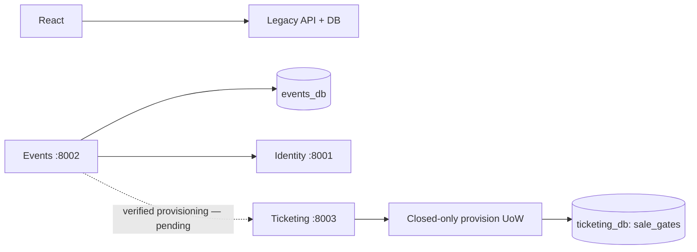

# H4 — Gate provisioning, closed-only core (offline)

## Scope

Adds an independent Ticketing application port and PostgreSQL adapter to register a **verified, committed Events UUID** as a gate initially `closed` at `version=0`, `event_revision=0`. Uses PostgreSQL `INSERT ... ON CONFLICT DO NOTHING` and a subsequent `SELECT ... FOR UPDATE` in the same transaction. Repeated calls preserve existing state, version and revision even if sales were opened; there is no reset-to-closed side effect.

**Important:** This is the persistence **core only**. There is deliberately **no new HTTP provisioning endpoint**. A shared Events service token is *not* proof that an arbitrary UUID represents a legitimate event. Until an Events-owned authenticated use case has verified the committed metadata, owner/actor via Identity, and calls a private provisioning endpoint with an auditable command identity, permitting remote provisioning would risk creating gates for arbitrary IDs.

## Integration boundaries

The new adapter and tests are not used by the active HTTP app. Existing `GET/POST .../sales/gates` command API remains disabled by default. The purchase gate lock and command idempotency logic are unchanged. No database migration, cross-service SQL, React, Legacy or production database mutations.

## Acceptance

- Unit test: first call closed/version 0; second call after gate state changes does not overwrite; transaction rollback on failure.
- Real disposable PostgreSQL tests: schema exists, creation, replay after open, parallel identical provisioning and no mutation to existing gate.
- CI: Ticketing Ruff, mypy, pytest, Alembic, Docker and all other regression checks.
- Follow-up: authenticated Events provisioning workflow, trusted remote endpoint with request ID and command identity, simulated timeout after commit, deterministic reconciliation, then publication orchestration.
