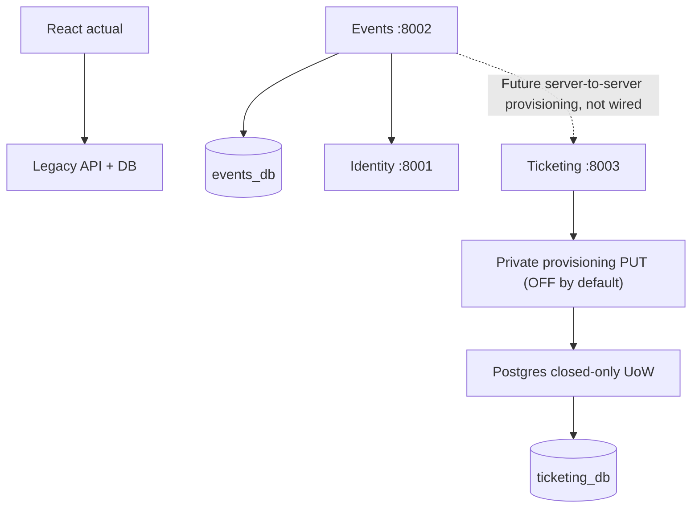

# H4 — Closed-only gate provision endpoint (opt-in, no commercial activation)

The internal **PUT** `/api/v1/internal/sales/gates/{event_id}/provision` delegates to the existing closed-only PostgreSQL UoW from PR #62. It is protected by the Events service credential `X-Internal-Service-Token` and a **separate default-off flag**, `GATE_PROVISIONING_ENABLED=false`. The ordinary compose overlay does not enable it.

- First valid request creates `closed/version=0/revision=0`.
- Replays use PostgreSQL conflict handling and never reset a gate's state/version/revision. An existing `open` gate is returned *as-is*, **not closed**. The caller cannot infer that a retry closed sales.
- Missing/incorrect credential => 401; missing server secret => 503; feature disabled => 404.
- Event UUID is the resource path, **not an authorization credential**. The sole permitted caller must be the Events server after fresh Identity authorization and verification of the committed future draft in its own DB.

## Security boundary

This PR does **not** implement the Events-side coordinator and deliberately does not enable the flag. The endpoint trusts a correctly authenticated Events service to attest to the event UUID; it cannot validate Events metadata by SQL cross-database reads. **Do not enable in any deployment until the Events coordinator verifies the UUID/owner/actor and durable command/reconciliation workflow.** A leaked service secret must be rotated. Bind service ingress only to private networks. No React, Gateway, Legacy or active data cutover.

## Architecture

## Test gates

HTTP unit tests cover default-off, missing/invalid service secret, initial closed state, idempotent repeat after opening, URL validation, no-store and unsupported methods. Existing PostgreSQL tests cover simultaneous provisioning and no reset, and run only in a disposable CI database. All other app jobs must remain green. Before production integration add Events-owned coordinator with Identity revalidation, committed event lookup, request IDs, stable command identity and reconciliation of uncertain responses.

