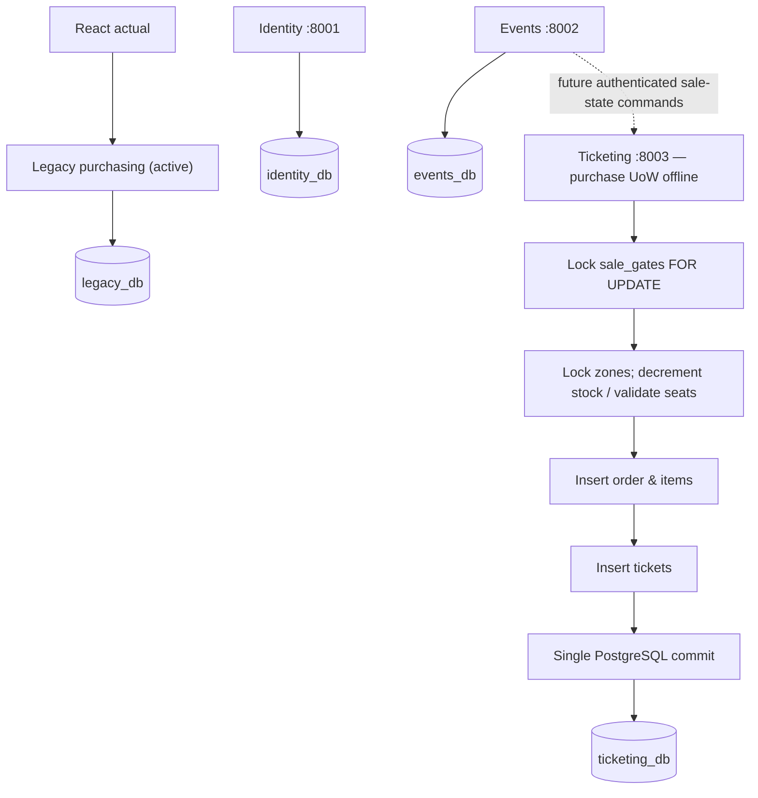

# H4 — Atomic purchase Unit of Work (not yet exposed)

This increment ports the Legacy purchase use case to the independent Ticketing service without enabling any public purchasing routes. It shares the **same Ticketing-owned PostgreSQL transaction and sale_gates row lock** with the previously introduced sale-state close command.

## Atomic operation



The actual web application still purchases against Legacy. Ticketing has **no POST /orders endpoint**, no externally exposed purchase use case, no data migration, no Events/Identity SQL cross-dependency and no new Alembic revision beyond `0003_orders_tickets`.

## Guarantees under test

1. The inbound caller will eventually validate the customer's role against Identity before entering this UoW; this is **not implemented yet**. The UoW cannot itself authenticate a user from another database.
2. Idempotency locks each customer transaction using `pg_advisory_xact_lock`, then checks existing orders **before** checking the sale gate. Historical confirmed replays return the same order even after close. A different intent with the same key conflicts. The UNIQUE constraint backs this up.
3. New purchases lock the same `sale_gates` record that a close command locks. They refuse missing or closed gates. Zones are locked in UUID order, then stock is decremented, order/items/tickets are inserted, and the UoW commits once.
4. Seat IDs must belong to a numbered zone and must not be duplicated or already sold. PostgreSQL unique seat constraints prevent concurrent double-booking.
5. A thrown error rolls back all stock/receipt/ticket changes; no partial order. No distributed transaction is claimed.

## Required acceptance before routing live traffic

- Real PostgreSQL tests of purchase/close ordering, idempotency retries and stock exhaustion, including race outcome proof.
- Role validation from Identity, Events metadata contract and service-to-service authorization for sale-state changes.
- End-to-end UAT across independently deployed Identity, Events and Ticketing with API/gateway; duplicate payments are not in scope.
- Migrate/backfill and reconcile existing demo data with backups before cutover.
- Fix any failed tests or lint detected by CI. Until then, this slice is unverified.

## Local safe commands

From `feat/h4-ticketing-atomic-purchase-uow`:

```powershell
$compose = @("-f", "docker-compose.yml", "-f", "docker-compose.ticketing.yml")
docker compose @compose --profile ticketing build ticketing
docker compose @compose --profile ticketing run --rm --no-deps ticketing ruff check .
docker compose @compose --profile ticketing run --rm --no-deps ticketing mypy ticketing_service
docker compose @compose --profile ticketing run --rm --no-deps ticketing python -m pytest tests -v
```

PostgreSQL-specific tests skip locally unless `TEST_POSTGRES_URL` points to a **disposable database**. Never point it at your active Ticketing, Events, Identity or Legacy volumes.
