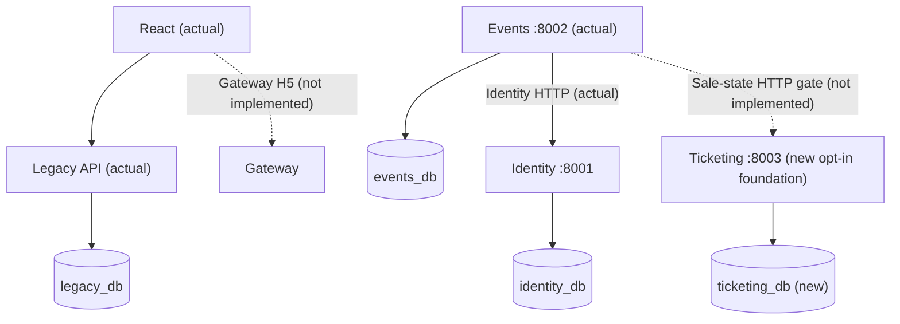

# H4 — Ticketing isolated sale gate foundation

This is the **first H4 vertical slice**: a separate Python/FastAPI process, isolated PostgreSQL database and Alembic migration, plus an executable transactional sale gate with a pure application use case and a SQLAlchemy unit of work.

It is deliberately NOT a functional Ticketing purchase service. The existing React and Legacy purchase flow are untouched.

## What exists

- `ticketing_service.domain` defines closed/open state, monotonically increasing versions and metadata revision constraints.
- `ticketing_service.application.change_sale_gate` orchestrates an abstract unit of work.
- `SqlAlchemyGateUnitOfWork` uses PostgreSQL `SELECT ... FOR UPDATE` on the owned sale gate row. It records command UUIDs and result snapshots in the **same database transaction**, permitting exact replay and rejecting conflicting command UUID reuse / stale versions.
- Alembic revision `0001_sale_gates`: owned sale-gate and command audit tables, no cross-service FK.
- Missing/unknown event IDs remain closed. Gate rows are **not provisioned by public HTTP**.
- Opt-in Docker overlay on port 8003; `GET /health` and a **read-only availability report**. There are no open/close, inventory, order or purchase HTTP routes.
- CI runs Ruff/mypy, unit tests, disposable PostgreSQL migration and row-lock proof, health and Docker image.

## Architecture (actual vs pending)



## Safe local test

On the branch `feat/h4-ticketing-sale-gate-foundation`, using PowerShell:

```powershell
$compose = @("-f", "docker-compose.yml", "-f", "docker-compose.ticketing.yml")
docker compose @compose --profile ticketing build ticketing
docker compose @compose --profile ticketing up -d --wait ticketing-db
docker compose @compose --profile ticketing run --rm --no-deps ticketing alembic upgrade head
docker compose @compose --profile ticketing up -d --wait ticketing
Invoke-RestMethod http://127.0.0.1:8003/health
Invoke-RestMethod http://127.0.0.1:8003/api/v1/internal/sales/availability
docker compose @compose --profile ticketing run --rm --no-deps ticketing ruff check .
docker compose @compose --profile ticketing run --rm --no-deps ticketing mypy ticketing_service
docker compose @compose --profile ticketing run --rm --no-deps ticketing python -m pytest tests -v
```

The last pytest PostgreSQL tests skip when `TEST_POSTGRES_URL` is absent locally. CI validates with its own ephemeral PostgreSQL. **Never point TEST_POSTGRES_URL at an active local database** because migrations/tests write test rows.

Do not use `docker compose down -v` or `--remove-orphans`; existing Identity/Events volumes must stay untouched.

## Explicit next gates

- Implement authenticated, scoped Events-to-Ticketing gate provisioning and commands. Unknown events cannot be opened with just a UUID.
- Port orders, stock and tickets to Ticketing's owned DB with the same gate lock protecting new purchases; prove both lock orders under actual PostgreSQL concurrency. The test in this PR only shows a **synthetic purchase-side gate lock**, not real order atomicity.
- Port idempotency and historical replay semantics; prove restart/retry/reconciliation, timeout, out-of-order gate commands and close vs purchase races.
- Implement Events orchestration only after sale-side guarantees. Keep remote unpublish disabled; do not switch React off Legacy yet.
