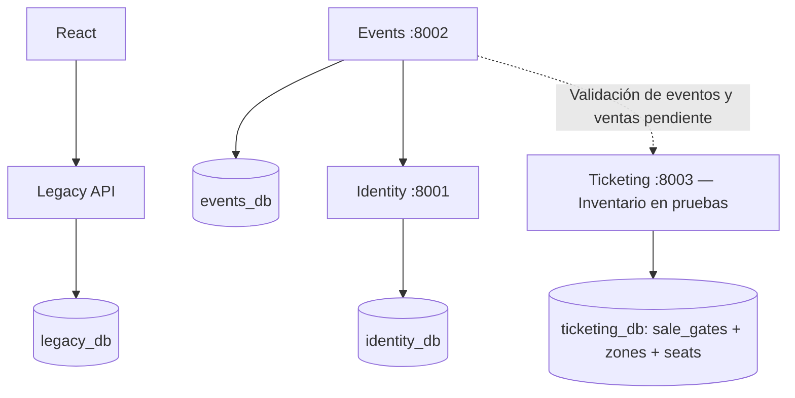

# H4 — Inventario propio de Ticketing (slice 2)

Las tablas de zonas y asientos ya están definidas en una **migración exclusiva de Ticketing** (`0002_inventory`). Los modelos replican las restricciones relevantes de Legacy: tipo de zona, monedas, precio, capacidad, disponibilidad, nombre único por evento y asientos exclusivamente para zonas numeradas.

No se copia ni se consulta la tabla Events. `zones.event_id` es UUID sin FK externa; Ticketing deberá validar con Events mediante un puerto/adaptador HTTP seguro cuando se habilite la creación real de zonas. Por ahora **no hay endpoints de altas de inventario ni compras**. No se migra información existente desde Legacy ni se ejecutan cambios en Legacy/Identity/Events.

## Diagrama simple

## Pruebas

CI debe ejecutar `ruff check .`, `mypy ticketing_service`, `pytest` con `TEST_POSTGRES_URL` descartable y `alembic upgrade head`; versión esperada `0002_inventory (head)`. Las pruebas PostgreSQL ejercitan FKs internas, restricciones de disponibilidad y ausencia de FKs a otras bases.

En Docker local, tras actualizar la rama y construir Ticketing, aplicar `alembic upgrade head` **solo a la DB de Ticketing en pruebas** y verificar `alembic current`. No ejecutar los tests de integración con `TEST_POSTGRES_URL` apuntando a un DB persistente ni eliminar volúmenes ajenos.

La próxima etapa es transacción de compra con stock + idempotencia + gate bloqueado en una misma UoW de Ticketing, seguida de tests de carreras contra cierre de ventas con PostgreSQL real.
