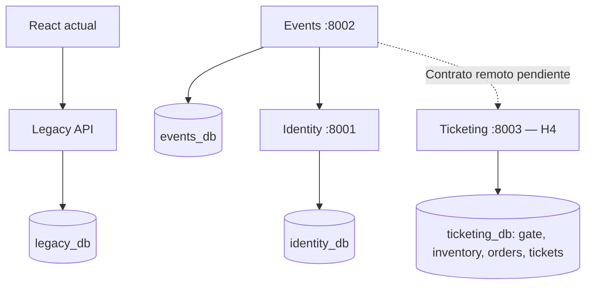

# H4 — Órdenes y tickets independientes (esquema solamente)

Este incremento incorpora migración `0003_orders_tickets` y ORM para `orders`, `order_items` y `tickets` en la **base exclusiva de Ticketing**. Preserva las constraints de integridad y unicidad de Legacy (idempotencia por cliente/clave, precio y subtotal, relación entre order-item y zone, asiento único y relación correcta con su zona).

Las referencias `customer_id` y `event_id` son UUID sin FK externa; solo Ticketing es propietario del inventario y las órdenes.

## Diagrama

**NO** significa que ya se pueda comprar desde Ticketing: no existe todavía la transacción de compra real, ni la emisión, ni la ruta POST habilitada, ni la verificación del evento/usuario con servicios externos. Ninguna tabla Legacy fue migrada ni modificada.

## Verificación

- CI ejecuta Ruff, mypy, tests PostgreSQL descartable, Alembic (esperado `0003_orders_tickets (head)`), health y build Docker.
- Tests verifican FK exclusivamente internas, ausencia de FK externas, idempotencia, subtotales y la posibilidad de persistir tickets generales.
- La siguiente slice debe extraer el caso de uso de compra del Legacy y realizar inventario + idempotencia + orden + tickets dentro de **una sola transacción**, tomando antes el mismo lock `sale_gates` que usa cierre.
- No habilitar comercio remoto ni mover React hasta superar carreras reales de compra/cierre y regresiones Legacy.
