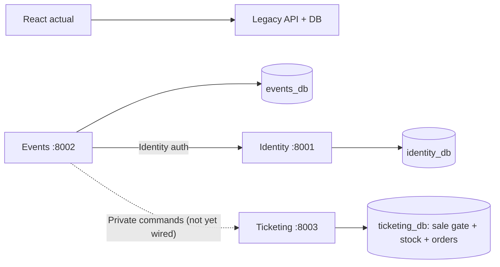

# H4 — Internal sale gate HTTP preview (no commercial cutover)

This increment adds a **private contract** to the existing Ticketing H4 service:
- `GET /api/v1/internal/sales/gates/{event_id}`: committed state (unknown event -> closed/version 0).
- `POST /api/v1/internal/sales/gates/{event_id}/commands`: `command_id`, `action=open|close`, `expected_version`, `event_revision`; authenticated using the Events-to-Ticketing service credential `X-Internal-Service-Token`.

The endpoint delegates all changes to the **existing** `change_sale_gate` use case and SQLAlchemy unit of work. It does not bypass the `SELECT ... FOR UPDATE` gate lock shared with the offline purchase transaction. Identical command replay returns the recorded state; reused IDs with a different payload, stale version/revision or unknown event return conflict.

## Safety boundaries

- The endpoints are **off by default**. The ordinary `docker-compose.ticketing.yml` does not enable them. The only activation mechanism added here is the explicit `docker-compose.ticketing-sales-preview.yml` overlay plus an operator-generated secret. Never commit or log real tokens.
- The credential is **not** an Identity bearer token and is not shared with the Identity introspection credential. Events must authenticate and authorize the human actor with Identity before sending an internal command.
- No endpoint provisions an unknown event gate: the separate, trusted initialization/verification flow with Events remains pending. Unknown gates are closed and cannot be opened.
- No HTTP purchase endpoint, no React routing changes, no Legacy mutations, no migration of data.
- Even with this preview enabled, publication/unpublication remains disabled until H3 Events orchestration, crash recovery and end-to-end racing tests are proven.

## Diagram

## Acceptance and next work

1. Local: ordinary Ticketing overlay returns `sale_commands_enabled=false` and commands 404; no impact on running local app.
2. CI: Ruff/mypy and unit HTTP tests for credentials, missing secret, unknown events, stale versions, replay, conflict, and POST disabled; PostgreSQL concurrency and migrations still green.
3. Next: implement trusted Events-to-Ticketing gate provisioning and remote orchestration (actor Identity revalidation, expected event revision), verify outages and indeterminate outcomes, then guarded real HTTP end-to-end.
4. Review carefully before enabling outside disposable test environments.
