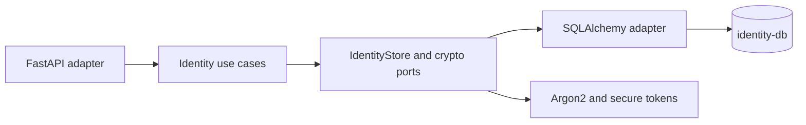

# Identity Service - independent preview

New standalone service in services/identity, with independent FastAPI runtime, Alembic migrations, PostgreSQL database and hexagonal boundaries. **It does not yet replace the legacy backend authentication.**

## Architecture



## Optional local preview (PowerShell)

Never use docker compose down -v and do not remove the legacy PostgreSQL volume.

```powershell
$env:IDENTITY_INTERNAL_TOKEN = [Convert]::ToHexString([System.Security.Cryptography.RandomNumberGenerator]::GetBytes(32))
docker compose -f docker-compose.yml -f docker-compose.identity.yml --profile identity up -d --build
docker compose -f docker-compose.yml -f docker-compose.identity.yml --profile identity exec identity alembic upgrade head
docker compose -f docker-compose.yml -f docker-compose.identity.yml --profile identity exec identity alembic current
```

Swagger at http://localhost:8001/docs and health at http://localhost:8001/health.
Users are separate from the original backend. Create an Identity admin interactively:

```powershell
docker compose -f docker-compose.yml -f docker-compose.identity.yml --profile identity exec -it identity python -m identity.create_admin --username admin_identity --display-name "Identity Admin"
```

Run isolated tests inside the new service with the same Compose flags and exec identity pytest -q.

## Security and limitations

- Internal introspection requires a Bearer user token and X-Internal-Service-Token, which must never be exposed to the browser.
- Auth sessions and roles are independently persisted. Token hashes and passwords are not returned.
- Users and tokens in the preview Identity DB cannot yet authorize purchases in the original backend.
- Existing Event.owner_id and Order.customer_id refer to legacy users via database foreign keys, requiring a separate cutover and schema migration.
- Until that migration is tested, the legacy frontend and checkout remain on the existing auth service.
- Etapa II remains paused.
