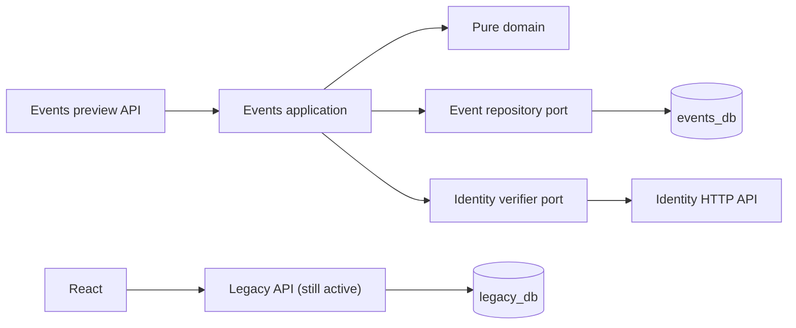

# H3 — Events Service independent foundation

## Context and dependency

H1 aporta contratos hexagonales preliminares; H2 Identity está en un servicio aislado, pero aún no es autoridad de escritura en el Legacy. H3 implementa Events aislado y opt-in sin romper el flujo React actual. H4 Ticketing y H5 gateway quedan posteriores.

## Target boundary

The Events preview must have independent process, container image, database, migration history and healthcheck. No import from `backend/app/models.py`, no cross-database foreign keys, no shared SQLAlchemy session. Use immutable UUID owner references.

## Hexagonal contracts

- `domain/`: status transitions, event constraints and business faults, no FastAPI/Pydantic/SQLAlchemy.
- `application/`: create/edit/publish/list use cases and repository / identity / clock ports.
- `adapters/inbound/`: HTTP DTOs and response mapping.
- `adapters/outbound/`: PostgreSQL persistence and internal Identity HTTP adapter, fail-closed.
- `bootstrap/`: dependencies, settings, app construction.

## Transaction and role safety

During H3, new Events operations must remain preview/opt-in. Remote role introspection cannot be treated as atomic with the Events DB; no irreversible business operations may depend on unproven cross-service race protection. For published events with inventory/sales, disallow remote unpublish or commercial edits until Ticketing sale-state coordination (H4/H5) is proven. A plain GET to another service is insufficient to serialize against sales.

## Migration and rollback

Create isolated `events_db` and run its migration in disposable CI first. A later explicit, read-only audit/export and reconciled import may preserve demo UUIDs. No DDL on the existing user's Legacy DB, and no router cutover from Legacy. Disabling the preview must restore original behavior without data deletion.

## Verification

Run independent tests, PostgreSQL migrations, Docker build, healthcheck, boundary import tests, negative authorization and partial-failure tests. Document real evidence; no "service complete" claim before deployment checks.
